<picture>
  <source media="(prefers-color-scheme: dark)" srcset="./assets/header-dark.svg"/>
  <source media="(prefers-color-scheme: light)" srcset="./assets/header-light.svg"/>
  
</picture>

<h1 align="center"><b>Hi there, I'm Shakib Khan</b> 👋</h1>

  <picture>
    <source media="(prefers-color-scheme: dark)" srcset="https://readme-typing-svg.demolab.com?font=JetBrains+Mono&weight=600&size=22&duration=3000&pause=1200&color=58A6FF&center=true&vCenter=true&multiline=true&repeat=true&width=900&height=80&lines=%F0%9F%9A%80+Backend+Engineer+%7C+%F0%9F%A4%96+AI+Engineer+%7C+%F0%9F%93%8A+Data+Engineer;%E2%98%81%EF%B8%8F+AWS+Certified"/>
    <source media="(prefers-color-scheme: light)" srcset="https://readme-typing-svg.demolab.com?font=JetBrains+Mono&weight=600&size=22&duration=3000&pause=1200&color=1E40AF&center=true&vCenter=true&multiline=true&repeat=true&width=900&height=80&lines=%F0%9F%9A%80+Backend+Engineer+%7C+%F0%9F%A4%96+AI+Engineer+%7C+%F0%9F%93%8A+Data+Engineer;%E2%98%81%EF%B8%8F+AWS+Certified"/>
    
  </picture>

 

&nbsp;**_Tech Stack_**

  

 

&nbsp;**_Competitive Programming_**

<picture>
  <source media="(prefers-color-scheme: dark)" srcset="https://leetcard.jacoblin.cool/shakib_12?theme=dark&font=JetBrains%20Mono&ext=heatmap&border=0"/>
  <source media="(prefers-color-scheme: light)" srcset="https://leetcard.jacoblin.cool/shakib_12?theme=light&font=JetBrains%20Mono&ext=heatmap&border=0"/>
  
</picture>

